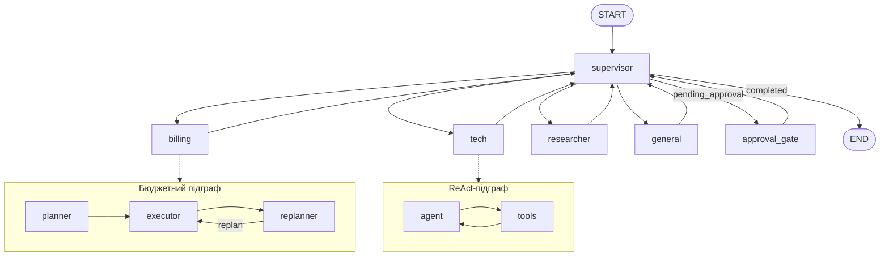
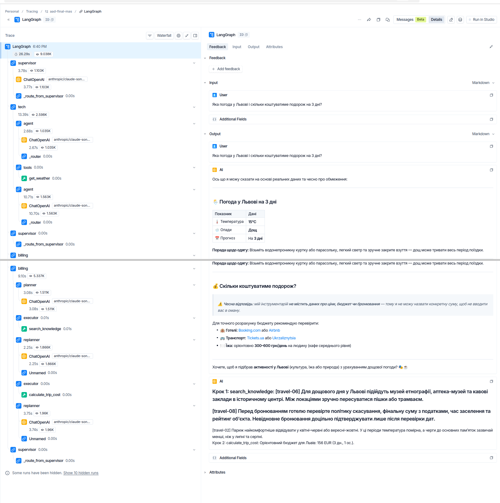

# Travel Support MAS

## Domain

Мультиагентна система туристичної підтримки: розраховує бюджет, добирає
активності, відповідає на запитання за базою знань і демонструє бронювання
з підтвердженням людини. Основна реалізація — LangGraph; альтернативна — CrewAI.
Інструменти доступні через MCP.

Погода, ціни та бронювання використовують локальні демонстраційні дані.
`demo` працює без API-ключів; `live` використовує LLM для рішень і відповідей,
але не підключає реальні туристичні сервіси.

## Architecture



| Агент | Відповідальність |
|---|---|
| supervisor | Структурована маршрутизація; завершення, handoff і перехід до підтвердження |
| billing | Планування бюджету, виконання та перепланування; підготовка бронювання |
| tech | Погода й активності через ReAct; передача бюджетної частини запиту billing |
| researcher | Туристичний FAQ і RAG з цитуванням `travel-XX` |
| general | Привітання, уточнення та відповіді поза доменом |

`MASApp.dispatch_tool` — спільна точка валідації та перевірки прав для
локальних LangChain-обгорток і MCP-tools. `connect_mcp()` підключає справжній
stdio-підпроцес через `MultiServerMCPClient`. Handoff обмежено одним переходом,
кількість відвідувань supervisor — вісьмома. Кожен спеціаліст має власний
`ExecutionGuard` з лімітами кроків, часу та повторів.

`AsyncSqliteSaver` зберігає стан за `thread_id`. Бюджетний executor зупиняє
ризиковий крок до виклику tool, а `approval_gate` очікує `Command(resume=...)`.
Повторне виконання однакового бронювання повертає наявний запис.

## Setup

Перевірене середовище — Python 3.12, Linux. `requirements.txt` і
`requirements-crewai.txt` містять повні знімки `pip freeze` відповідних
середовищ із фіксованими прямими та транзитивними залежностями.

```bash
python3.12 -m venv .venv
source .venv/bin/activate
pip install -r requirements.txt
cp .env.example .env
pip check
```

Для локальних демонстрацій `.env` можна залишити без ключів. Для live-запитів
заповніть `OPENROUTER_API_KEY` або `GOOGLE_API_KEY`. Провайдер задається
параметром `MASApp(provider="demo"|"openrouter"|"gemini")`; модель — змінними
`OPENROUTER_MODEL` або `GEMINI_MODEL`. Файл `.env` ігнорується Git.

## Run

```bash
# Кілька туристичних запитів через LangGraph і MCP, без LLM
python mas_langgraph.py

# Окремий MCP-сервер (stdio; очікує протокольного клієнта)
python mcp_server.py

# Відновлення стану в новому процесі
python persistence_demo.py

# Підтвердження, відмова та редагування бронювання
python hitl.py approve
python hitl.py reject
python hitl.py edit
python hitl.py invalid-edit

# Пауза і продовження в окремих процесах
python hitl.py pause
python hitl.py resume approve

# Локальні оцінювання та перевірки захисту
python guardrails.py
python evals.py --mode demo
python red_team.py --mode demo

# Автоматичні тести
python -m pytest tests/ -q
```

Приклад API для live-запиту:

```python
import asyncio
from dotenv import load_dotenv
from mas_langgraph import MASApp

async def main():
    load_dotenv()
    mas = MASApp(provider="openrouter")
    await mas.connect_mcp()
    state = await mas.handle_query("Оціни бюджет Львова на 3 дні для двох")
    print(state["results"])

asyncio.run(main())
```

Робочі дані демонстрацій зберігаються в `runtime/`. `persistence_demo.py`
оновлює приклади `agent_state.db`, `chroma_db/` і `trajectory.json` у корені.
Шляхи можна перевизначити через `PERSISTENCE_DB_PATH`,
`PERSISTENCE_KNOWLEDGE_PATH`, `PERSISTENCE_TRAJECTORY_PATH` і
`PERSISTENCE_RUNTIME_DIR`. Ці збережені приклади показують стан після
відновлення; для звичайної роботи достатньо окремих runtime-сховищ.

## MCP Tools, Resources and Reused Components

| Примітив | Назва | Призначення |
|---|---|---|
| Tool | `get_weather` | Демонстраційна погода міста |
| Tool | `calculate_trip_cost` | Бюджет за містом, днями й кількістю людей |
| Tool | `find_activities` | Активності за містом та інтересом |
| Tool | `search_knowledge` | Пошук у ChromaDB з ідентифікаторами документів |
| Tool | `book_hotel` | Локальне ідемпотентне бронювання |
| Resource | `faq://general` | Статичний туристичний FAQ |
| Resource | `travel://cities` | Каталог міст із демонстраційними даними |
| Prompt | `travel_reply` | Шаблон відповіді з імʼям, описом звернення й тоном |

MCP-сервер повторно валідує аргументи Pydantic-схемами. Помилки повертаються
через `isError=True`; логи пишуться у stderr. `MCP_KNOWLEDGE_PATH` і
`MCP_BOOKING_PATH` задають сховища. Прямий MCP-клієнт сам відповідає за
контроль доступу: HITL і рольові дозволи застосовуються в MAS.

База знань містить 10 документів. `LocalHashEmbedding` забезпечує локальний
детермінований пошук без embedding API. `data/knowledge_seed.json` — читабельний
знімок документів; тест перевіряє його відповідність `knowledge.py`.
`data/red_team_fixtures.json` містить синтетичні дані для перевірок захисту.

Спільні компоненти: доменні tools і Pydantic-схеми, ChromaDB RAG,
`ExecutionGuard` та `TrajectoryLogger`. Планувальний і ReAct-цикли інтегровані
як підграфи. Логування розширено полем `agent_name`, маскуванням ключів і PII.

## Guardrails and HITL

| Механізм | Ризик | Приклад |
|---|---|---|
| Input guardrail | ASI01 | «Ignore all previous instructions…» і «Забудь все попереднє…» блокуються до виконання агентів |
| Output guardrail | ASI06, обмеження витоку | Email, телефон, картка, IBAN та ІПН маскуються у відповідях і локальній траєкторії |
| Tool allowlist | ASI02/ASI03 | researcher і tech не можуть виконати `book_hotel` |
| Rate limiter | ASI08 | 31-й запит за 60 секунд у тій самій сесії блокується |
| HITL | ASI09 | Бронювання очікує approve/reject/edit; edit повторно проходить Pydantic-валідацію |

HITL показує назву tool, аргументи й ідентифікатор операції. `approve` виконує
дію; `reject` завершує без запису; `edit` змінює аргументи перед валідацією.
Невалідне рішення або невідповідна роль не дають виконати бронювання.

## Evaluation

`eval_results.json`: **5/5 (100%) у demo-режимі** — simple billing,
multi-step tech, RAG-heavy, cross-agent і HITL. Записи містять запит,
pass/fail, latency, agents_used і tools_called. `trace_id` може бути `null`.

`red_team_results.json`: **7/7 у demo-режимі**, без обходу в перевірених
сценаріях: англомовна інʼєкція, PII, scope confusion, обхід HITL,
україномовна інʼєкція, інʼєкція через RAG та rate limit. RT-03 і RT-06 —
контрольовані перевірки dispatcher; вони не вимірюють схильність live-LLM
самостійно обрати шкідливу дію. PII у fixtures вигадані.

Для повторного live-оцінювання: `python evals.py --mode live` та
`python red_team.py --mode live`. Потрібен OpenRouter; ці команди
перезаписують відповідні JSON-результати.

## Tracing

Заповніть `LANGSMITH_API_KEY`, установіть `LANGSMITH_TRACING=true` і запустіть
`python observability.py` з ключем OpenRouter. Траси містять supervisor,
вкладені підграфи, tool-виклики та handoff.

Збережені live-приклади (доступ до LangSmith може вимагати авторизації):

- [Billing: 12,47 с, 6493 токени](https://smith.langchain.com/o/7d1cdab8-d9f4-4f98-b71e-5dab3d437da5/projects/p/157b2dab-bf4d-45ea-997f-8d2eadb07588/r/01a07270-e048-7780-a6c3-aae323b08d68).
- [Tech → billing: 26,29 с, 9038 токенів](https://smith.langchain.com/o/7d1cdab8-d9f4-4f98-b71e-5dab3d437da5/projects/p/157b2dab-bf4d-45ea-997f-8d2eadb07588/r/01a07271-1104-7e00-b26e-dd233c63377a).



Маскування локальних відповідей і траєкторій не охоплює всі сирі inputs та
outputs автоматичних LangSmith callbacks. Приклади трасування не містять
PII; red-team сценарії з синтетичними PII виконуються без трасування.

## OWASP ASI 2026 Matrix

| Ризик | Актуальність | Захист | Залишковий ризик |
|---|---|---|---|
| ASI01 Agent Goal Hijack | Висока: довільний ввід і RAG | Input regex на запитах і tool results | Перефразування та кодування можуть обійти regex |
| ASI02 Tool Misuse and Exploitation | Висока: інструменти змінюють стан | Pydantic, allowlist, ліміт повторів, ідемпотентність | Валідні аргументи можуть бути недоречними за змістом |
| ASI03 Identity and Privilege Abuse | Висока: різні права ролей | Роль задається контрольованим execution context | Немає автентифікації MCP-клієнта |
| ASI04 Agentic Supply Chain Vulnerabilities | Середня: сторонні залежності | Фіксовані версії пакетів | Немає hash-pinning, SBOM і сканування вразливостей |
| ASI05 Unexpected Code Execution | Середня: MCP-підпроцес | Типізовані tools, відсутність eval/exec над LLM-виводом | Підпроцес має права батьківського процесу; sandbox відсутній |
| ASI06 Memory and Context Poisoning | Висока: RAG і checkpoints | Фільтрація tool results, маскування PII | Збережений стан не сканується повторно; output redaction не очищує памʼять |
| ASI07 Insecure Inter-Agent Communication | Низька: один процес | Спільний typed state, явний handoff | Типізація й tracing не підписують повідомлення |
| ASI08 Cascading Failures | Висока: LLM і повторні виклики | Timeout, max_steps, rate limit, ліміт supervisor | Немає глобального circuit breaker між сесіями |
| ASI09 Human-Agent Trust Exploitation | Висока: підтвердження бронювання | Interrupt, явне рішення, повторна валідація edit | Оператор не автентифікується; знання thread_id не є авторизацією |
| ASI10 Rogue Agents | Середня: вихід за роль або цикл | Allowlist, max_handoffs, loop detector, evals | Немає зовнішнього kill switch та автоматичного моніторингу аномалій |

### Residual Risks

Ключові обмеження локального прототипу: довіра до процесу й оператора,
евристична фільтрація та відсутність системного sandbox. Для використання
з реальними бронюваннями потрібні автентифікація оператора і MCP-клієнтів,
перевірка збереженого контексту, ізоляція MCP з мінімальними правами та
перевірка походження залежностей.

## Framework Comparison (CrewAI)

CrewAI використовує hierarchical coordinator і трьох спеціалістів: billing,
tech, researcher. Кожен отримує окремий MCP allowlist. `book_hotel` недоступний,
оскільки ця реалізація не має HITL і durable persistence.

Через несумісні версії транзитивних залежностей потрібне окреме середовище.
MCP-сервер запускається Python-інтерпретатором основного `.venv`.

```bash
python3.12 -m venv .venv-crewai
.venv-crewai/bin/pip install -r requirements-crewai.txt
.venv-crewai/bin/pip check
.venv-crewai/bin/python -m pytest tests/test_mas_crewai.py -q
.venv-crewai/bin/python mas_crewai.py "Оціни бюджет Львова на 3 дні для двох"

# Live-порівняння; OpenRouter і LangSmith для метрик LangGraph
.venv/bin/python compare_frameworks.py both
.venv/bin/python count_loc.py
```

`comparison_results.json` містить вимірювання чотирьох однакових запитів через
MCP, з моделлю `anthropic/claude-sonnet-4.6` і температурою 0,1. Один warm-up
на фреймворк відкинуто; **N=1 на сценарій**, тому цифри описують конкретні
запуски, без статистичної оцінки варіативності.

| Сценарій | LangGraph: час / токени | CrewAI: час / токени | Спостереження |
|---|---|---|---|
| Бюджет | 16,7 с / 6499 | 40,8 с / 37464 | Обидва повернули 312 EUR |
| Погода й активності | 21,5 с / 3870 | 42,1 с / 34860 | Обидва викликали два інструменти |
| RAG | 6,8 с / 2001 | 58,1 с / 43060 | LangGraph цитує travel-04; CrewAI додає непідтверджені деталі |
| Handoff | 4,2 с / 1104 | 111,5 с / 94620 | LangGraph помилково обрав general; CrewAI делегував tech → billing |

Час розробки не вимірювався: `dev_time: null`. Цю метрику неможливо
достовірно відновити з тривалості LLM-запитів або часу між комітами.

| Код | LOC |
|---|---|
| LangGraph (MAS і HITL) | 1233 |
| CrewAI | 203 |
| Спільні модулі | 915 |

LOC включає docstrings і виключає порожні та суто коментарні рядки.
Відмінність обсягу не є оцінкою продуктивності фреймворків: LangGraph також
реалізує HITL, persistence та інтеграцію всіх guardrails.

### Results Analysis

CrewAI зручний для початкового прототипу: role/goal/backstory задають
спеціалістів, а manager делегує без ручного графа. Практична складність —
взаємодія Task з hierarchical manager. Явне `Task(agent=coordinator)`
обмежувало delegation самим coordinator; робоча конфігурація залишає
`agent` незаданим. Цей випадок покритий регресійною перевіркою.

LangGraph потребує більше явного коду стану й переходів, але дає контроль
над умовами, порядком і зупинкою виконання. Handoff tech → billing задається
кодом, тому після правильного первинного routing не потребує додаткового
LLM-рішення. У збереженому cross-agent запуску первинний supervisor обрав
`general`, і handoff не відбувся. Це показує, що детермінована структура
графа сама по собі не гарантує правильного LLM-routing.

CrewAI успішно делегував обидві частини складного запиту, витративши
111,5 секунди та 94620 токенів. Гнучкість manager має вартість додаткових
LLM-кроків. Для простих запитів LangGraph у цих вимірюваннях витрачав менше
часу й токенів. Порівнювати швидкість невдалого cross-agent запуску з
успішною відповіддю CrewAI як рівноцінні результати некоректно.

Для debugging у LangGraph корисні `MASState`, `RouteDecision.reasoning`,
локальна траєкторія та дерево LangSmith: видно конкретний вузол помилки.
CrewAI дає читабельні verbose-логи; структуровані дані про агентів і tools
збираються через event bus у `mas_crewai_bench.py`. В обох випадках фінальна
відповідь потребує перевірки на відповідність даним tools: у RAG-запуску
CrewAI додав деталі, яких не було в джерелі.

Для прототипу з простими ролями CrewAI скорочує обсяг ручного workflow-коду.
Для розвитку цього застосунку з ризиковими діями доцільна реалізація
LangGraph: вона вже має durable checkpoint і явне підтвердження до booking.
Висновок стосується реалізованих конфігурацій; один запуск на сценарій не
доводить загальної переваги фреймворку.
